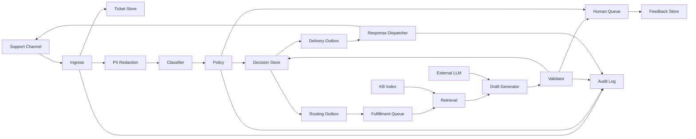

# Архитектура обработки обращений

> **Audience: For AI**

Построчное сравнение PoC и цели — в [таблице README](../README.md#что-реализовано-а-что-спроектировано); проектные свойства ниже нигде не выдаются за гарантии кода.

Одна фраза, которую описывает вся схема: быстрая модель предлагает тему, детерминированная policy ограничивает действие, retrieval даёт основание, validator разрешает автоответ, всё остальное уходит человеку.

## Схема

## Два контура

**Синхронный, бюджет < 500 мс:** ingress → PII → classify → policy → persist audit → route.
Retrieval и LLM в него не входят, поэтому их отказ не задерживает маршрутизацию к человеку. PoC пишет факт в `RoutingDecision.sync_route_ms`: максимум по шести сценариям — `8.8 ms` на холодном S1, остальные ≤ `0.3 ms`. Это smoke-замер одной машины, не production SLA.

**Асинхронный:** queue → retrieval → draft → validate → final outbox.
В PoC вызывается inline и виден только через `FulfillmentStatus`. Задание на human routing всегда приоритетнее генерации: тикет не ждёт освобождения LLM-квоты, чтобы попасть оператору.

Ключевые свойства потока:

- Ingress требует `idempotency_key` и маскирует PII до всего остального; routing decision и fulfillment job фиксируются одной транзакцией.
- За границу очереди проходит только `SanitizedTicket` — исходного текста там нет.
- Право на автоответ выдаёт единолично validator: citation из реальных hits, `auto_allowed`, публикация, owner, срок действия, отсутствие PII и обещаний, лимит 1200 символов. LLM создаёт только текст и никогда не выполняет возврат средств, блокировку аккаунта или изменение подписки.

## Capacity planning

| Параметр | Расчёт |
|---|---|
| Normal RPS | `200 000 / 86 400 = 2,31` |
| Peak RPS | `20 000 / 600 = 33,3`, примерно `×14` к среднему |
| Доля auto-candidate | `37%` — допущение для планирования, не automation rate из eval |
| p95 LLM latency | не измерена; верхняя оценка — timeout `2 с` |
| Concurrency в пик | `ceil(33,3 × 0,37 × 2) = 25` одновременных вызовов |
| Ёмкость за пик | `(25 / 2) × 600 = 7 500` заданий против `7 400` входящих |
| **Запас** | **`1,35%`, то есть эксплуатационного запаса нет** |

Retrieval, валидация и служебные расходы в расчёт не входят, а съедают запас первыми. Поэтому решение, а не только констатация: **пул считается на 60% целевой загрузки — около 42 вызовов вместо 25**, сверх этого действует жёсткий бюджет concurrency, при исчерпании генерация отключается в пользу утверждённых incident-шаблонов. Отказ от генерации на пике безопаснее растущей очереди: маршрутизация и человеческий контур продолжают работать.

**Incident mode.** Детектор всплеска агрегирует обращения по теме и создаёт `incident_id`; дубликаты группируются под ним, повтор по `idempotency_key` получает сохранённое решение, свободная генерация заменяется утверждённым шаблоном. Policy и Human Queue приоритета не теряют. Пороги и backpressure — в [рисках и эксплуатации](risks-and-ops.md).

## Состояния

В коде PoC живут только наблюдаемые `RoutingStatus` и `FulfillmentStatus`. Целевая машина шире; ключевые переходы и их владельцы:

| Из | В | Владелец перехода |
|---|---|---|
| `RECEIVED` → `ROUTED` → `QUEUED_FOR_FULFILLMENT` | — | routing orchestrator, затем outbox publisher |
| `VALIDATING` | `PENDING_DELIVERY` \| `NEEDS_HUMAN` | validator: успех либо любая непройденная проверка |
| `PENDING_DELIVERY` | `COMPLETED` \| `FAILED_RETRYABLE` | dispatcher по ответу канала |
| `FAILED_RETRYABLE` | `QUEUED_FOR_FULFILLMENT` \| `FAILED_FINAL` | retry scheduler в пределах TTL и лимита попыток |

Любое состояние может уйти в `NEEDS_HUMAN` — это и есть fail-closed. У событий общий `correlation_id`, `sequence` монотонно растёт внутри него, новый retry получает новый `attempt_id`. «Ровно два события» относится только к упрощённому PoC.

## Хранилища

| Хранилище | Source of truth | Retention | PII | Консистентность |
|---|---|---|---|---|
| Ticket Store | да, для исходного обращения | по политике удаления, напр. 1 год | да | strong write, чтение по least privilege |
| Decision Store | да, для состояния и дедупликации | срок тикета + окно разбирательств | только ссылки и маски | ACID, unique index по `idempotency_key` |
| Routing и delivery outbox | нет, производны от решения | до подтверждённой публикации | только ссылки и маски | одна ACID-транзакция с решением, publish eventual |
| Immutable Audit Sink | нет: ни state, ни dedupe | по требованиям аудита, напр. 3 года | без исходного текста | append-only, порядок по `correlation_id` |
| KB CMS и Index | CMS для контента, индекс производный | история версий | нет | CMS strong, индекс eventual |
| Feedback и Labeling Store | да, для labels после review | по циклу обучения | псевдонимизировано | append + immutable snapshots |

**Границу нельзя размывать:** Decision Store и outbox коммитятся атомарно, audit sink получает копию отдельно. В PoC все три роли вырождены в один JSONL, а дедупликация — словарь в памяти, теряемый при рестарте.

## Интеграции и очереди

| Интеграция | Timeout и retry | Идемпотентность | При отказе |
|---|---|---|---|
| Входные каналы | ack ≤ 500 мс, повтор по контракту канала | `channel + external_ticket_id + event_version` | дубликат получает сохранённое решение |
| Ticketing и Human Queue | 2 с, backoff, до 3 попыток | stable operator-job key | retry queue → DLQ; от LLM не зависит |
| LLM API | `2 с`, максимум 2 попытки в пределах TTL | ключ на попытку, сохранённый draft | approved template либо оператор |
| Доставка в канал | 2 с, backoff, до 3 попыток | stable delivery key + dedupe | retry до TTL, затем `DELIVERY_FAILED` и оператор |

Circuit breaker защищает только внешнюю LLM и никогда не отключает classifier, policy и human routing; в PoC его нет, fallback действует на один запрос.

**Два outbox обязательны.** Первый фиксирует `routing decision + fulfillment job`, второй — `final decision + delivery job`. Иначе процесс падает после commit решения, но до публикации задания, и тикет теряется.

**`AUTO_RESPONSE` означает не «текст сформирован», а «создано надёжное задание на отправку».** Outbox даёт at-least-once, дедупликация доставки — effectively-once. Exactly-once через внешнюю границу недостижим.

## Человек и деградация

Оператор получает рискованные темы, low-confidence, `UNKNOWN`, отсутствие контекста и любой draft, не прошедший validator. Интерфейс фиксирует принятие черновика, объём правки, фактическую категорию, reopen и CSAT — эти сигналы ценнее усложнения prompt.

| Отказ | Поведение |
|---|---|
| Policy недоступна | автоматизация запрещена |
| Retrieval пуст или score низкий | генерации нет |
| LLM недоступна | approved template, иначе оператор |
| Статья просрочена, не опубликована или в ответе PII | validator блокирует |
| Audit недоступен | автоматического действия нет |

## Deployment, SLO, RTO и RPO

Один регион, stateless routing-инстансы, durable queue, ограниченный пул workers. Ниже проектные цели, не измеренные свойства PoC.

| Параметр | Значение |
|---|---|
| Доступность синхронного routing | `99,9%` в месяц |
| p95 routing | `< 500 мс` |
| First response (SLA кейса) | p95 от приёма до автоответа или появления в очереди оператора `≤ 15 мин`, доля уложившихся `≥ 95%` |
| LLM-вызов | завершение или безопасный fallback за `2 с` |
| RPO | `0` для подтверждённого решения, outbox и аудита; незакоммиченный draft допустимо потерять |
| RTO | `15 мин` для routing без generation; LLM может остаться отключённой |

Routing за миллисекунды сам по себе SLA не гарантирует: между маршрутизацией и ответом лежат очередь и генерация.

**Почему не микросервисы.** 33 RPS распределённость не оправдывают. PoC — модульный монолит; в целевой системе classifier и generation стоит разнести из-за разных SLA, стоимости и характера отказов, а не из-за нагрузки. Policy и human routing обязаны работать независимо от внешней LLM.
