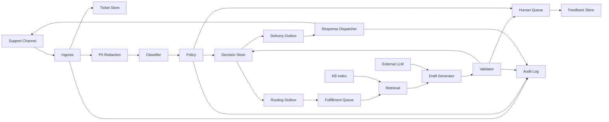

# Архитектура обработки обращений

> **Audience: For AI**

## Реализовано и спроектировано

| Возможность | PoC | Целевая система |
|---|---|---|
| Приём и нормализация | Локальный Python ingress | Адаптеры каналов с аутентификацией и rate limit |
| Защита PII | Redaction до границы очереди | DLP, шифрование и отдельный PII vault |
| Классификация | TF-IDF и Logistic Regression | Версионируемый model service с canary rollout |
| Policy | Детерминированные fail-closed правила | Версионируемый policy service с four-eyes review |
| Асинхронность | `fulfill` вызывается inline | Durable queue, retry scheduler и DLQ |
| Идемпотентность | In-memory словарь решений | Decision Store с unique index по `idempotency_key` |
| Аудит | Два события в JSONL | Append-only журнал с контролем целостности и schema registry |
| База знаний | Markdown и ленивый TF-IDF индекс | CMS, approval workflow и обновляемый hybrid index |
| Генерация | Детерминированный mock и template fallback | Внешняя LLM за rate limiter и circuit breaker |
| Доставка | Решение и текст без реального dispatcher | Второй outbox, idempotent dispatcher и delivery events |

Это разграничение принципиально: ниже проектные свойства не выдаются за гарантии текущего кода.

## Схема

## Компоненты и поток данных

| Компонент | Зачем он существует |
|---|---|
| Ingress и normalizer | Создают единый контракт и ключ идемпотентности для разных каналов. |
| PII redaction | Закрывает типом путь передачи исходных персональных данных за routing-контур. |
| Classifier | Даёт дешёвый, быстрый и воспроизводимый сигнал темы. |
| Policy | Сохраняет бизнес-риск детерминированным и независимым от вероятностных моделей. |
| Retrieval | Привязывает ответ к управляемому знанию и возвращает governance-метаданные. |
| Draft generator | Создаёт только текстовый черновик и безопасно деградирует без LLM. |
| Validator | Единолично выдаёт право на auto-response после grounding, governance и safety-проверок. |
| Decision Store и outbox | Делают решение идемпотентным и не дают потерять последующее задание. |
| Audit Log | Позволяет восстановить причины решения, версии и попытки без роли operational state. |
| Dispatcher и Human Queue | Разделяют надёжную доставку и обработку, требующую человеческого решения. |

Поток начинается с канального события. Ingress проверяет обязательный `idempotency_key`, сохраняет исходный тикет в защищённый Ticket Store, нормализует и маскирует PII. Classifier возвращает тему, confidence и top-3, затем policy либо немедленно направляет риск оператору, либо разрешает асинхронное наполнение. Routing decision и fulfillment job фиксируются одной транзакцией.

Worker получает только `SanitizedTicket`, ищет контекст, формирует draft и передаёт его validator. Низкая релевантность прекращает генерацию. Validator сверяет citation с найденными hits, `auto_allowed`, публикацию, owner, срок действия, PII, обещания и лимит `1200` символов. Успех для `AUTO_CANDIDATE` создаёт финальное решение и delivery job; любой запрет создаёт operator job. LLM создаёт только текстовый draft и никогда не выполняет возврат средств, блокировку аккаунта или изменение подписки.

## Синхронный и асинхронный контуры

Синхронная граница: ingress → PII → classify → policy → persist audit → route. Её бюджет — менее 500 мс. PoC пишет фактическое значение в `RoutingDecision.sync_route_ms`; в локальном интеграционном прогоне 2026-08-10 максимум шести сценариев составил `8.8 ms` на холодном S1, остальные — не более `0.3 ms`. Это smoke-замер одной машины, не production SLA. Retrieval и LLM не входят в этот бюджет, поэтому их отказ не задерживает первичную операторскую маршрутизацию.

Асинхронная граница: queue → retrieval → draft → validate → final outbox. В PoC этот контур вызывается inline и виден только через `FulfillmentStatus`; durable queue и dispatcher спроектированы. Приоритет задания на human routing всегда выше генерации: тикет не ждёт освобождения LLM-квоты, чтобы попасть оператору.

## Capacity planning

| Параметр | Расчёт |
|---|---|
| Normal RPS | `200 000 / 86 400 = 2,31 RPS` |
| Peak RPS | `20 000 / 600 = 33,3 RPS`, то есть примерно `×14` к среднему |
| Доля auto-candidate | `37%` — допущение для capacity planning; не равна automation rate из development eval |
| p95 LLM latency | Не измерена. Для верхней оценки используется timeout `config.LLM_TIMEOUT_S = 2 с`; измеренный classification p95 из [eval report](eval_report.md) — `< 1 ms` |
| Concurrency воркеров в пик | `ceil(33,3 × 0,37 × 2) = ceil(24,64) = 25` одновременных LLM-вызовов |
| Разбор накопившейся очереди | Если все `20 000 × 0,37 = 7 400` generation jobs уже накопились: `7 400 / (25 / 2) = 592 с ≈ 9,9 мин`. При непрерывной обработке за пик поступит `7 400`, а идеальная ёмкость составит `(25 / 2) × 600 = 7 500` jobs: запас всего `(7 500 − 7 400) / 7 400 = 1,35%`. Retrieval, validation и служебные накладные расходы не учтены, поэтому эксплуатационного запаса нет: очередь разбирается за 10 минут только в идеальных условиях, а любая деградация retrieval выводит обработку за этот SLA |

## Incident mode и дедупликация

Детектор всплеска агрегирует входящие обращения по теме; при массовом росте одной темы создаётся `incident_id`. Нормализованные дубликаты группируются под одним incident, а повторные события с тем же `idempotency_key` получают уже сохранённое решение. Для известного incident retrieval и свободная генерация заменяются заранее утверждённым incident-шаблоном. Пул генерации имеет жёсткий лимит параллельности, тогда как policy и постановка в Human Queue сохраняют приоритет и не ждут LLM. Конкретные пороги, backpressure и поведение под нагрузкой описаны в [рисках и эксплуатации](risks-and-ops.md).

Полная целевая машина состояний:

| Из | В | Владелец перехода |
|---|---|---|
| `RECEIVED` | `ROUTED` | Routing orchestrator после policy и первого outbox commit |
| `ROUTED` | `NEEDS_HUMAN` | Policy adapter для запретного или неопределённого случая |
| `ROUTED` | `QUEUED_FOR_FULFILLMENT` | Routing outbox publisher |
| `QUEUED_FOR_FULFILLMENT` | `FULFILLING` | Fulfillment worker после lease задания |
| `FULFILLING` | `VALIDATING` | Draft generator после template или LLM draft |
| `FULFILLING` | `NEEDS_HUMAN` | Fulfillment worker при отсутствии надёжного контекста |
| `FULFILLING` | `FAILED_RETRYABLE` | Fulfillment worker при временной инфраструктурной ошибке |
| `VALIDATING` | `PENDING_DELIVERY` | Validator и транзакция финального outbox |
| `VALIDATING` | `NEEDS_HUMAN` | Validator при любой непройденной проверке |
| `PENDING_DELIVERY` | `COMPLETED` | Response Dispatcher после подтверждения канала |
| `PENDING_DELIVERY` | `FAILED_RETRYABLE` | Response Dispatcher при временном отказе канала |
| `FAILED_RETRYABLE` | `QUEUED_FOR_FULFILLMENT` | Retry scheduler в пределах TTL и лимита попыток |
| `FAILED_RETRYABLE` | `FAILED_FINAL` | Retry scheduler после исчерпания попыток или TTL |
| `NEEDS_HUMAN` | `COMPLETED` | Ticketing adapter после решения оператора |

В коде PoC существуют лишь наблюдаемые `RoutingStatus` и `FulfillmentStatus`; полная машина — target design. У событий общий `correlation_id`, а `sequence` монотонно растёт внутри него. Новый retry получает новый `attempt_id`. На попытку допустимо больше двух событий: started, failed, retried и completed. Формулировка «ровно два события» относится только к упрощённому PoC с `ROUTING_DECIDED` и `FULFILLMENT_COMPLETED`.

## Граница Decision Store / outbox / audit sink

| Хранилище | Содержимое | Source of truth | Retention | PII | Консистентность |
|---|---|---|---|---|---|
| Ticket Store | Исходный текст, канал, customer reference, encrypted metadata | Да, для исходного обращения | По договору и политике удаления, например 1 год | Да | Strong write; чтение по least privilege |
| Decision Store | Текущее routing/final state и `idempotency_key` | Да, для состояния и дедупликации; unique index по `idempotency_key` | Срок тикета плюс окно разбирательств | Только ссылки и маскированные данные | ACID |
| Routing и delivery outbox | Задания на fulfillment, доставку или оператора | Нет; производны от решения | До подтверждённой публикации плюс окно повторов | Только ссылки и маскированные данные | Пишутся одной ACID-транзакцией с соответствующим решением; publish eventual |
| Immutable Audit Sink | Версии, причины, метрики, transitions и attempts | Нет: не используется ни для state, ни для dedupe, ни для повторной публикации | По требованиям аудита, например 3 года | Нет исходного текста; маски минимизируются | Только append, последовательность на `correlation_id` |
| KB CMS и Index | Статьи, owner, approval, expiry, векторы и lexical index | CMS для контента; индекс производный | История версий без бессрочного serving старого документа | Нет | CMS strong; индекс eventual и версионирован |
| Feedback и Labeling Store | Принятие draft, diff, итоговая категория, reopen, CSAT, reject reason | Да, для обучающих labels после review | По циклу обучения и privacy policy | Псевдонимизированные признаки | Append и периодические immutable snapshots |

В целевой системе Decision Store и соответствующая outbox-запись коммитятся атомарно; audit sink получает неизменяемую копию события отдельно. В PoC все три роли вырождены в один JSONL без транзакционных границ; process-local in-memory словарь лишь имитирует дедупликацию и теряется при рестарте.

## Интеграции, очереди и два outbox

| Интеграция | Timeout и retry | Идемпотентность | Поведение при отказе |
|---|---|---|---|
| Входные каналы | Target: быстрый ack до 500 мс, повтор по contract канала | `channel + external_ticket_id + event_version` | Дубликат возвращает сохранённое решение; невалидное событие в quarantine |
| Ticketing API и Human Queue | Target: 2 с, exponential backoff, максимум 3 попытки | Stable operator-job key | Временная ошибка в retry queue, затем DLQ; routing к человеку не зависит от LLM |
| LLM API | В PoC `LLM_TIMEOUT_S = 2.0`; target — максимум 2 короткие попытки в пределах job TTL | Request key на attempt и сохранённый draft | Timeout, rate limit или circuit open дают approved template либо оператора |
| Support Channel delivery | Target: 2 с, exponential backoff, максимум 3 попытки | Stable delivery key и dedupe у dispatcher | Retry до TTL относительно SLA, затем `DELIVERY_FAILED` и оператор |

У очередей есть ограничение concurrency, отдельные приоритеты, TTL задания относительно SLA и DLQ. Rate limiter внешней LLM учитывает provider quota; worker не создаёт неограниченный параллелизм. Retry разрешён только для временных ошибок. Circuit breaker защищает только внешнюю LLM и никогда не отключает classifier, policy или human routing. В текущем PoC circuit breaker не реализован: fallback действует на один запрос.

Нужны два transactional outbox. Первый атомарно фиксирует `routing decision + fulfillment job`; второй — `final decision + delivery/operator job`. Иначе процесс может упасть после decision commit, но до публикации задания, и тикет потеряется.

Delivery flow: `Decision Store + Outbox → Response Dispatcher → Support Channel`. `AUTO_RESPONSE` означает не «текст сформирован», а «создано надёжное задание на отправку». Dispatcher отправляет идемпотентно и отдельно пишет `DELIVERY_COMPLETED` или `DELIVERY_FAILED`; этих событий в PoC нет. Outbox даёт at-least-once, а дедупликация доставки — effectively-once. Гарантировать exactly-once через внешнюю границу нельзя.

## Человек, обратная связь и деградация

Оператор получает рискованные темы, low-confidence, `UNKNOWN`, отсутствие контекста и любой draft, не прошедший validator. Интерфейс фиксирует принятие draft, объём правки, фактическую категорию, причину отклонения, reopen и CSAT. После privacy-фильтра и временного split эти сигналы попадают в evaluation dataset; они ценнее усложнения prompt.

Отказ policy всегда закрывает автоматизацию. Отказ retrieval или низкий score исключает генерацию. Ошибка LLM даёт локальный approved template; отсутствие безопасного template ведёт к человеку. Просроченная, review-статья либо PII в ответе блокируются validator. Поведение под нагрузкой и эксплуатационные пределы вынесены в [риски и эксплуатацию](risks-and-ops.md), здесь задана только структура очередей и восстановления.

## Deployment assumptions, SLO, RTO и RPO

Целевая поставка — один регион, несколько stateless routing-инстансов за балансировщиком, durable queue и ограниченный пул fulfillment workers. Проектные цели, а не измеренные свойства PoC: доступность синхронного routing `99,9%` в месяц и p95 `< 500 ms`; для generation отдельно — LLM-вызов завершается либо переходит в безопасный fallback за timeout `2 с`, а end-to-end p95 задаётся после production-замера. RPO для committed decision, outbox и audit — `0`: подтверждённое решение и аудит терять нельзя; незакоммиченный draft допустимо потерять и пересоздать либо передать оператору. RTO routing без generation — `15 мин` (проектное допущение); внешний LLM может оставаться отключённым после восстановления маршрутизации.

## Почему не микросервисы

Расчётные 33 RPS не оправдывают распределённость сами по себе. PoC — модульный монолит: меньше сетевых границ, проще воспроизводимость и безопасная сдача. В target classifier и generation можно разнести из-за разных SLA, стоимости, scaling profile и характера отказов, а не из-за текущей нагрузки. Policy и human routing должны оставаться доступными независимо от внешней LLM.
